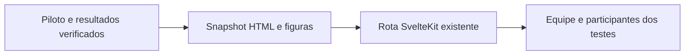

# RBX Systems — Public Website

Public-facing institutional website for **RBX Systems** (`merovelis.com/pt-br` / `merovelis.com/en`).
Built with **SvelteKit 5**, **TypeScript** and `@sveltejs/adapter-node` (SSR).

Content (site pages and blog posts) is stored in a private S3-compatible bucket
(`rbx-content`) and read server-side through the Content Gateway. No build-time
prerender is required.

## Domains

- `merovelis.com/pt-br` — Brazilian Portuguese (pt-BR)
- `merovelis.com/en` — English (en)

The two earlier hosts, `rbx.ia.br` and `rbxsystems.ch`, redirect page by page to the same page
here. The design, its trade-offs and what has to be true before it goes live are in
`docs/adr/ADR-0003-one-host-language-by-path.md`.

## Development

```bash
pnpm install
pnpm dev
```

## Build

```bash
pnpm build
```

## Checks

```bash
pnpm check
pnpm lint
```

## Public assistant and the LLM gateway

`POST /api/chat` (`src/routes/api/chat/+server.ts`) answers the chat widget. Each
request makes one completion request to the LLM gateway, and nothing is retried by
the server: a retry is the visitor's choice and counts against the same rate limit
(30 requests per address in five minutes, per pod).

The gateway request has a deadline that covers the connection, the headers and the
body. It is 35 s by default and `LLM_GATEWAY_TIMEOUT_MS` overrides it with a whole
number of milliseconds from 1 to 60000. Any other value is ignored, with one warning
in the pod log, and the default applies, so a wrong value cannot turn the deadline
off. The gateway is configured to give its provider call 30 s
(`router_settings.timeout` in `apps/prod/llm-gateway/litellm-config.yml`, `rbx-infra`
main at `0a0dc03`, read on 2026-11-14). The default sits above that on purpose: the
gateway's own timeout error can arrive first, and the deadline is left for a gateway
that does not answer at all.

The trade-off: a visitor can wait up to 35 s, with the widget frozen, before a
silent gateway shows as an error. A shorter deadline would show it sooner and would
also cut answers the gateway is still producing. The other way round, an answer the
gateway takes longer than 35 s to give, because its timeout was raised or because it
retries its provider, is cut here. The default has to be reviewed with the gateway
configuration; nothing checks one against the other.

| What fails                                          | What `/api/chat` answers                       | What the visitor gets                              | How it shows in the pod log                                    | Recovery                   |
| --------------------------------------------------- | ---------------------------------------------- | -------------------------------------------------- | -------------------------------------------------------------- | -------------------------- |
| The gateway is not configured                       | 503                                            | The connection error, with a retry button          | Nothing: the answer itself                                     | Configure the gateway      |
| The gateway answers an HTTP error                   | 502, `AI service unavailable`                  | The connection error, with a retry button          | `[chat] LLM gateway error`, with the status and the error body | Gateway back               |
| The gateway answers OK with a body that is not JSON | 502, `AI service unavailable`                  | The connection error, with a retry button          | `[chat] LLM gateway answer is not JSON`, without the body      | Gateway back               |
| The connection is refused, reset or cut mid-answer  | 502, `code: "gateway_unreachable"`             | The connection error, with a retry button          | `[chat] LLM gateway unreachable`, with the error code          | Gateway reachable again    |
| The gateway accepts the request and stays silent    | 504 at the deadline, `code: "gateway_timeout"` | The timeout error, with a retry button             | `[chat] LLM gateway timed out`, with the deadline              | Gateway answering again    |
| Too many requests from one address                  | 429                                            | A line asking to wait                              | Nothing                                                        | Automatic after the window |
| This application dies or is unreachable mid-request | Nothing, or an error from the ingress          | The connection error, with a retry button          | Probes on `/healthz`                                           | Pods back                  |
| The network stalls between the browser and the site | Nothing                                        | The widget stays frozen until the browser gives up | Nothing                                                        | A known gap, see below     |

The log lines of the deadline and of a failed connection carry neither what the
visitor wrote nor the gateway credential. The error body of the gateway is logged as
the gateway sent it, as it was before the deadline existed. The widget keeps the
visitor's message after a failure, so the retry button asks again without retyping,
and it stays frozen while a request is pending. The deadline is the server's: the
request the browser makes to `/api/chat` has none of its own, which is the last row
of the table. `scripts/chat-gateway.test.mjs` runs the real handler against a fake
gateway for the gateway rows.

## Public-assistant RAG shadow

The chat BFF can duplicate only the latest user question to the governed Thalamus
`POST /rbx/v1/rag/shadow/retrieve` route. It is disabled by default and never uses
retrieved hits to construct or modify the public answer. Enable it only with
`THALAMUS_RAG_SHADOW_ENABLED=true`, `THALAMUS_URL`, and a
`THALAMUS_RAG_TOKEN` service credential limited to `thalamus:rag:retrieve`.
`THALAMUS_URL` must use HTTPS outside loopback development. Redirects are
rejected so the bearer credential is never forwarded to another origin.

When enabled, each chat operation adds exactly one bounded HTTP request, started in
parallel with the existing completion. It has a 1500 ms default timeout, no retry,
a 256 KiB response cap, and validates the fixed public package and visibility.
Logs contain only status/reason, or validated trace/audit IDs on success; query
text, context, and tokens are never logged. A slow Thalamus can add at most the configured timeout to
the request, while an unavailable or malformed shadow dependency never changes the
live chat result. This latency trade-off is accepted only for shadow measurement.

## SEO / Content

- Metadata, Open Graph and JSON-LD are managed via `src/lib/design/components/Seo.svelte`.
- `robots.txt` is one host-wide endpoint and `sitemap.xml` is an index of the localized `/pt-br/sitemap.xml` and `/en/sitemap.xml` endpoints (`src/routes/robots.txt/+server.ts` and `src/routes/sitemap.xml/+server.ts`), not static files. The localized sitemaps list the static pages plus the Journal posts, tag pages and author pages derived from the CMS content.
- See `docs/seo/` for the full SEO strategy, editorial plan and publishing checklist.

## Publishing a blog post

See `docs/AGENT-BLOG-PUBLISHING.md` and `docs/BLOG.md`.

---

© RBX Systems. All rights reserved.

## PI IV: criminalidade local em São Paulo

`/estudos/criminalidade-sp` publica um protótipo acadêmico independente para
revisão e testes da equipe. A RBX fornece domínio e infraestrutura de apoio,
sem aquisição de outro domínio. O endereço facilita demonstrações, acesso em
computador e celular e coleta de feedback; a hospedagem não comprova validação
comunitária ou conclusão do produto acadêmico.

A rota entrega um snapshot HTML/CSS/JavaScript e SVG, preparado a partir do piloto
local de 21/10/2026. A interface ainda não foi reescrita em componentes Svelte.
O processamento analítico em Node.js/TensorFlow.js ocorre antes da publicação.
Amostra: 75 agregados anuais, três circunscrições policiais, anos completos
2002–2025 e 2026 parcial; 69 observações são usadas no agrupamento. A coleta da
fonte é manual. A interface identifica origem, período e limitações. Não há
previsão de risco ou inferência causal.



| Opção | Avaliação para esta publicação |
| --- | --- |
| Rota no domínio existente | Escolhida: reutiliza HTTPS e hospedagem; exige publicar uma imagem do site. |
| Subdomínio independente | Possível evolução; exige DNS, TLS e hospedagem próprios. |
| Novo domínio | Aquisição e manutenção adicionais sem necessidade para os testes. |

A rota realiza uma resposta HTTP, sem consultas a banco ou APIs externas.
Filtros e gráficos funcionam no navegador, sem requisições adicionais; os três
PNGs são carregados somente ao abrir seus links. Seus nomes incluem hashes para
invalidar cache após mudanças. O HTML tem cache de um minuto, CSP com hash do
script e metadado `noindex` para a versão de testes. Não há formulários, gravação,
autenticação, rastreamento adicional ou processamento de dados pessoais.

| Falha | Comportamento e recuperação |
| --- | --- |
| Fonte criminal indisponível | A versão publicada mantém o snapshot datado; atualização permanece manual. |
| Banco, S3 ou serviços analíticos indisponíveis | O painel não os consulta e mantém o conteúdo incorporado. |
| Site ou hospedagem indisponível | O acesso público falha; o HTML original continua disponível no pacote local. Reverter a promoção da imagem restaura a versão anterior do site. |

A rota não integra o protótipo a um eventual repositório da equipe. A decisão de
incorporar a solução e as evidências dos testes deve ser registrada no PI.
