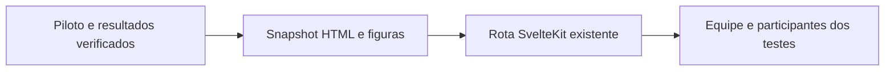

# RBX Systems — Public Website

Public-facing institutional website for **RBX Systems** (`rbx.ia.br` / `rbxsystems.ch`).
Built with **SvelteKit 5**, **TypeScript** and `@sveltejs/adapter-node` (SSR).

Content (site pages and blog posts) is stored in a private S3-compatible bucket
(`rbx-content`) and read server-side through the Content Gateway. No build-time
prerender is required.

## Domains

- `rbx.ia.br` — Brazilian Portuguese (pt-BR)
- `rbxsystems.ch` — English (en)

## Development

```bash
pnpm install
pnpm dev
```

## Build

```bash
pnpm build
```

## Checks

```bash
pnpm check
pnpm lint
```

## Public-assistant RAG shadow

The chat BFF can duplicate only the latest user question to the governed Thalamus
`POST /rbx/v1/rag/shadow/retrieve` route. It is disabled by default and never uses
retrieved hits to construct or modify the public answer. Enable it only with
`THALAMUS_RAG_SHADOW_ENABLED=true`, `THALAMUS_URL`, and a
`THALAMUS_RAG_TOKEN` service credential limited to `thalamus:rag:retrieve`.
`THALAMUS_URL` must use HTTPS outside loopback development. Redirects are
rejected so the bearer credential is never forwarded to another origin.

When enabled, each chat operation adds exactly one bounded HTTP request, started in
parallel with the existing completion. It has a 1500 ms default timeout, no retry,
a 256 KiB response cap, and validates the fixed public package and visibility.
Logs contain only status/reason, or validated trace/audit IDs on success; query
text, context, and tokens are never logged. A slow Thalamus can add at most the configured timeout to
the request, while an unavailable or malformed shadow dependency never changes the
live chat result. This latency trade-off is accepted only for shadow measurement.

## SEO / Content

- Metadata, Open Graph and JSON-LD are managed via `src/lib/design/components/Seo.svelte`.
- `robots.txt` and `sitemap.xml` are dynamic per-host endpoints (`src/routes/robots.txt/+server.ts` and `src/routes/sitemap.xml/+server.ts`), not static files. The sitemap lists the static pages plus the Journal posts, tag pages and author pages derived from the CMS content.
- See `docs/seo/` for the full SEO strategy, editorial plan and publishing checklist.

## Publishing a blog post

See `docs/AGENT-BLOG-PUBLISHING.md` and `docs/BLOG.md`.

---

© RBX Systems. All rights reserved.

## PI IV: criminalidade local em São Paulo

`/estudos/criminalidade-sp` publica um protótipo acadêmico independente para
revisão e testes da equipe. A RBX fornece domínio e infraestrutura de apoio,
sem aquisição de outro domínio. O endereço facilita demonstrações, acesso em
computador e celular e coleta de feedback; a hospedagem não comprova validação
comunitária ou conclusão do produto acadêmico.

A rota entrega um snapshot HTML/CSS/JavaScript e SVG, preparado a partir do piloto
local de 21/10/2026. A interface ainda não foi reescrita em componentes Svelte.
O processamento analítico em Node.js/TensorFlow.js ocorre antes da publicação.
Amostra: 75 agregados anuais, três circunscrições policiais, anos completos
2002–2025 e 2026 parcial; 69 observações são usadas no agrupamento. A coleta da
fonte é manual. A interface identifica origem, período e limitações. Não há
previsão de risco ou inferência causal.



| Opção | Avaliação para esta publicação |
| --- | --- |
| Rota no domínio existente | Escolhida: reutiliza HTTPS e hospedagem; exige publicar uma imagem do site. |
| Subdomínio independente | Possível evolução; exige DNS, TLS e hospedagem próprios. |
| Novo domínio | Aquisição e manutenção adicionais sem necessidade para os testes. |

A rota realiza uma resposta HTTP, sem consultas a banco ou APIs externas.
Filtros e gráficos funcionam no navegador, sem requisições adicionais; os três
PNGs são carregados somente ao abrir seus links. Seus nomes incluem hashes para
invalidar cache após mudanças. O HTML tem cache de um minuto, CSP com hash do
script e metadado `noindex` para a versão de testes. Não há formulários, gravação,
autenticação, rastreamento adicional ou processamento de dados pessoais.

| Falha | Comportamento e recuperação |
| --- | --- |
| Fonte criminal indisponível | A versão publicada mantém o snapshot datado; atualização permanece manual. |
| Banco, S3 ou serviços analíticos indisponíveis | O painel não os consulta e mantém o conteúdo incorporado. |
| Site ou hospedagem indisponível | O acesso público falha; o HTML original continua disponível no pacote local. Reverter a promoção da imagem restaura a versão anterior do site. |

A rota não integra o protótipo a um eventual repositório da equipe. A decisão de
incorporar a solução e as evidências dos testes deve ser registrada no PI.
