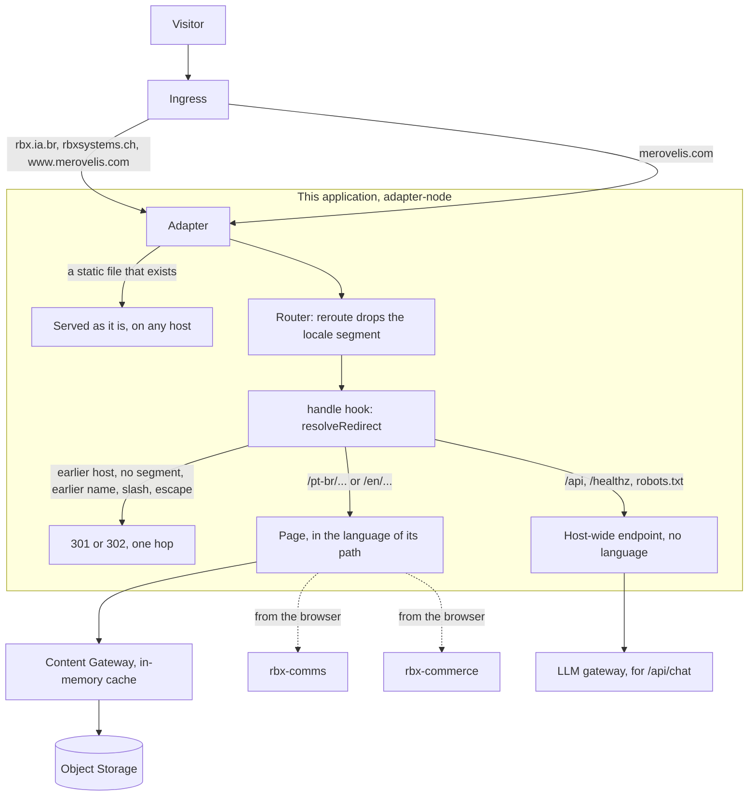

# ADR-0003: One host, language by path

**Status**: Accepted (owner decision of 2026-11-13). Implemented in the code; nothing is live
until the steps under "Before this goes live" are done.

**Date**: 2026-11-13

**Program**: RBX Institutional Site / rbx-systems-frontend

## Context

The site answered on two hosts, and the host chose the language: `rbx.ia.br` in Portuguese
and `rbxsystems.ch` in English. Every absolute address in the code (canonical, hreflang,
JSON-LD ids, sitemap, feed, robots) was built from one of the two hosts, and the locale of a
request was read from its host name.

The owner decided on 2026-11-13 that the institutional site moves to `merovelis.com`:

1. The institutional site replaces the site that `merovelis.com` served until then.
2. Both languages live on that host, each under a path prefix: `/pt-br/` and `/en/`. The root
   is negotiated from the browser language, English when nothing matches. `x-default` is English.
3. `rbx.ia.br/x` redirects permanently to `merovelis.com/pt-br/x`, and `rbxsystems.ch/x` to
   `merovelis.com/en/x`, page by page, with no end date. Both domains stay registered.

This record covers what that means inside this repository. It does not cover DNS, ingress,
certificates, e-mail, the name shown in the texts, or the other services: those are separate
steps with their own decisions.

## Decision

### Address of a page

- One origin, `https://merovelis.com`, in one constant (`src/lib/seo/site.ts`).
- The first path segment names the language: `/pt-br` or `/en`, lower case
  (`src/lib/i18n/locale.ts`). The locale of a request is read from there and from nowhere else.
- Each route keeps its spelling per language: `/pt-br/sobre` and `/en/about`. One address per
  page per language: the spelling of the other language under a segment redirects
  (`/en/sobre` to `/en/about`).
- An address is written one way: no trailing slash, the segment in lower case, no escape of a
  character that needs none. Anything else redirects to that form.
- Route folders carry no locale. The `reroute` hook (`src/hooks.ts`) drops the segment before
  the router matches, and `event.url` keeps the address as requested.
- Paths that belong to the host and not to a language are served without a segment and do not
  exist under one: `/api`, `/_app`, `/healthz`, `/robots.txt`, `/rss-style.xsl`, `/estudos` and
  the static files.
- Three files depend on the language and live under the segment: `sitemap.xml`, `rss.xml`,
  `llms.txt`. Without a segment, `/sitemap.xml` is the index of the two sitemaps and
  `/llms.txt` is the English index, at the address its convention expects.

### Redirects

Every redirect this application decides is decided by one pure function, `resolveRedirect` in
`src/lib/seo/redirects.ts`, called first in `src/hooks.server.ts`. Whatever applies to a
request is applied together, so the answer is the final address and keeps the query string.

| Request                                                                                             | Answer                                                               |
| --------------------------------------------------------------------------------------------------- | -------------------------------------------------------------------- |
| `/healthz`, any host                                                                                | never redirected                                                     |
| earlier host, page                                                                                  | 301 to the same page on the site host, in the language of that host  |
| earlier host, `sitemap.xml`, `rss.xml`, `llms.txt`                                                  | 301 to the file of that language                                     |
| earlier host, host-wide path that the application answers                                           | 301 to the same path on the site host                                |
| site host, page path without a segment, spelling of one language (`/sobre`)                         | 301 to that language                                                 |
| site host, any other page path without a segment (`/`, `/journal`)                                  | 302, negotiated from `Accept-Language`, English when nothing matches |
| site host, earlier name of a page or the spelling of the other language, under a segment            | 301 to the live page                                                 |
| trailing slash, segment in another case, needless escape (`/en/about/`, `/EN/about`, `/en/%61bout`) | 301 to the address written the one way                               |
| `www.merovelis.com`                                                                                 | 301 to the bare name, in the same hop as any change of path          |
| `/briefing-btc`                                                                                     | 301 to the landing host, as before                                   |

An earlier name of a page is a retired path of the previous sites (`/aboutus`), a post under
`/journal/{slug}` (it lives at `/blog/{slug}`) or a tag by an alias (`/journal/tag/risco` is
`/journal/tag/risk`). They are resolved by `livePath` in `src/lib/seo/alternates.ts`, which
the redirects and the links share.

A request that is not a read (POST) gets 308 or 307 in place of 301 or 302, so its method
survives. One kind of request is answered before it gets that far: a form submitted from
another origin is refused (below).

Four things are decided outside that function, and are stated here so that "one hop" claims
no more than it does:

- **A static file that exists** (`/favicon.svg`, `/brand/...`, `/_app/...`) is served by the
  adapter before the application is asked, on any host. An earlier host keeps answering for
  its images, which is what an old page or an old link preview needs.
- **The router redirects a trailing slash on its own, before the hook.** A request for an
  earlier host with a trailing slash would then take two hops. Every route therefore declares
  `trailingSlash = 'ignore'` (the root layout and each `+server.ts`; a test checks it), and
  the hook drops the slash in the same redirect as the rest.
- **The framework refuses a form submitted from another origin, before the hook.** SvelteKit
  compares the `Origin` header of a form submission (a POST, PUT, PATCH or DELETE with a form
  content type) with the origin of the deployment and answers 403 when they differ or the
  header is missing. The origin of a deployment is its `ORIGIN`, not the host that was asked
  for. So a form submitted to an earlier host by a page of that host is redirected with 308
  only by a deployment whose `ORIGIN` is that host. The deployment of the site host answers
  it with 403 and no `Location`. The check stays as the framework ships it and no other
  origin is trusted (`csrf.trustedOrigins` in `svelte.config.js` is empty). Nothing the site
  offers is lost: it has no form action and no endpoint that reads a form body. Its forms are
  sent by script, as JSON, to rbx-comms, to rbx-commerce and to `/api/chat`, and a request
  that is not a form submission reaches the hook and is redirected with its method.
- **Which slug a post has in a language** is known to the post lists, not to a pure function.
  A post may have its own slug per language (`slugAlias`), and an earlier host was also asked
  for posts by their storage slug. When a redirect lands on a post, the hook completes it with
  the public slug (`toPublicPostSlug` in `src/hooks.server.ts`), so that request takes one hop
  too. It takes the slug from the post lists that are already in memory and from nowhere
  else: a redirect reads nothing from storage, waits for nothing and leaves nothing pending,
  whatever storage is doing. A pod that has served no post and no Journal page since it
  started holds no list yet; its redirect goes out without the completion and the loader of
  the post, which reads the lists, redirects from there. That second hop happens until the
  lists are first read, and not again: the cache keeps a list for as long as the pod runs.
  A request that is already on the site host under its segment is redirected by the loader
  of the post, as before. A permanent redirect that leaves a route without a cache rule gets
  the same bound as the ones the hook decides, so this one is bounded too.

### What points at an address

- Canonical, `og:url`, hreflang, sitemap, feed, `llms.txt`, breadcrumb and JSON-LD addresses
  are built by `localizedUrl` and `SITE_ORIGIN`. Each is an address that is served: the
  organization names the home page of the language of the page and the site names the English
  one, because the root answers with a redirect.
- Internal links are built by `localizedHref` and `siteHref` (`src/lib/seo/alternates.ts`).
  `siteHref` reads an address the way a request for it is read and writes the address the
  server answers directly: an earlier name is resolved, the spelling follows the language, a
  needless escape or a trailing slash goes. A link that names its language keeps it, by a
  locale segment or by an absolute address on an earlier host.
- Links inside stored content go through `siteHref` when the Content Gateway renders it, and
  a link to a post is completed there with the slug the post has in that language. The `<a>`
  tags are read as HTML writes them (any case, any quoting), because stored pages carry HTML
  written by hand. The value of an `href` is read as a browser reads it: HTML decodes its
  character references (`&amp;`, `&#47;`), and the URL parser drops the spaces and control
  characters around it and the tabs and line breaks inside it. An address that changes is written back in quotes, with
  the ampersand and that quote as character references, so the value ends where the author
  ended it. An address that does not change keeps the bytes the author wrote.
- The organization, the site and each person have one JSON-LD id each, the same in both
  languages. The two earlier hosts left `sameAs`: they redirect here.
- A post names `x-default` only when it has an English version.
- The language switch is a link to the same page under the other segment, and it loads a new
  document. On a post it goes to the address the post has in that language, and to the
  Journal of that language when the post has no version there.
- The services the browser calls (rbx-comms, rbx-commerce) keep their two public names. The
  Portuguese section calls the name the Portuguese host called, the English section the other.
- The chat API has one address, so the page tells it which language section the visitor is in.

## Options considered

| Question                                               | Option                                                                                    | For                                                                                                                                                         | Against                                                                                                                                      | Chosen          |
| ------------------------------------------------------ | ----------------------------------------------------------------------------------------- | ----------------------------------------------------------------------------------------------------------------------------------------------------------- | -------------------------------------------------------------------------------------------------------------------------------------------- | --------------- |
| Where the language is                                  | Path prefix for both, `/pt-br` and `/en`                                                  | One host concentrates reputation; hreflang on one host; the address says the language                                                                       | Every link and absolute address must carry the segment                                                                                       | Yes (owner, 2A) |
|                                                        | One language at the root, the other under a prefix                                        | Shorter addresses for one language                                                                                                                          | One language becomes the main one; two rules for links                                                                                       | No              |
|                                                        | One language per subdomain                                                                | Smallest code change                                                                                                                                        | Two hosts again, reputation split as before                                                                                                  | No              |
| How the segment reaches the routes                     | `reroute` hook, folders unchanged                                                         | No route moves; both spellings stay plain folders                                                                                                           | The route id does not say the language; links must be built by a helper                                                                      | Yes             |
|                                                        | A `[[lang]]` parameter at the top of the route tree                                       | The router knows the language                                                                                                                               | Every route folder moves; the two spellings of a route need a matcher each                                                                   | No              |
| Where the earlier hosts redirect                       | In this application                                                                       | The mapping needs the route table, which lives and is tested here                                                                                           | The earlier hosts must keep reaching the application; its outage is theirs too                                                               | Yes             |
|                                                        | In the ingress                                                                            | Redirects survive an outage of the application                                                                                                              | The route table would be copied into ingress rules and drift                                                                                 | No              |
| The root                                               | Negotiated from `Accept-Language`                                                         | A Portuguese browser lands in Portuguese                                                                                                                    | A 302 no cache may store; a crawler, which sends no language, sees English                                                                   | Yes (owner, 2A) |
|                                                        | Fixed English                                                                             | Cacheable, simplest                                                                                                                                         | Portuguese visitors arrive in English                                                                                                        | No              |
| Remembering a language                                 | No cookie                                                                                 | No state, nothing to consent to, the answer depends only on the request                                                                                     | Entering by the root again negotiates again                                                                                                  | Yes             |
|                                                        | A locale cookie                                                                           | A returning visitor keeps a choice that differs from the browser                                                                                            | State, consent, and a root whose answer depends on it                                                                                        | No              |
| A post asked for by a slug that is not its public slug | The hook completes a redirect that lands on a post, from the post lists already in memory | One hop for every earlier address once the lists were read; the redirect function stays pure; a redirect never reads storage, never waits and holds nothing | Two hops for such an address on a pod that has not read the lists yet                                                                        | Yes             |
|                                                        | The hook reads the lists when they are not in memory, with a deadline                     | One hop also on a cold pod, when storage answers in time                                                                                                    | Every redirect that times out stays attached to the shared read for as long as storage is silent: memory grows with traffic during an outage | No              |
|                                                        | Left to the loader of the post                                                            | No redirect ever reads storage                                                                                                                              | A second hop for every such address of an earlier host                                                                                       | No              |

## Trade-offs of what was chosen

- **Every link has to be built by a helper.** A path written by hand has no segment. It still
  works, through a redirect, but a path that is the same in both languages is negotiated and
  can change the language. Tests fail when a component writes a path by hand, and the check of
  the built site fails when a rendered page names an address that redirects or leaves its
  language.
- **The earlier hosts depend on this application.** If its pods are down, old links are down
  too. Left on the table: redirects that outlive the application.
- **The root is not cacheable** (`Vary: Accept-Language`, `no-store`). Every entry by the root
  costs a request to the application.
- **No locale cookie.** A visitor whose browser language is not the one they read in clicks
  the switch again when they enter by the root. Every other address already names its language.
- **Permanent redirects are bounded to one hour in the browser** (`Cache-Control:
max-age=3600`), whoever sends them: the hook, or the loader of a route (a post asked for by
  another slug, a tag by an alias). A browser keeps an unbounded 301 for good, so a wrong
  mapping could not be corrected. The cost: one request per hour per old address per visitor.
  Search engines treat the 301 as permanent either way.
- **The language switch loads a new document.** Several components decide once, from the
  address, which service to call and which dictionary to use. A full load starts them again,
  as it did when each language had its own host. The cost: the switch is not an in-place
  navigation.
- **One entity id per organization, site and person.** Search engines read one entity
  described in two languages. The cost: the ids change from the ones the earlier hosts
  published.
- **Only the two exact earlier names (and their `www`) are redirected as earlier hosts.** A
  preview or a pod address is treated as the site host and gets a `Location` without a host,
  so no redirect ever echoes a host name from the request.
- **A form submitted from another origin is refused, not redirected.** The alternative is to
  trust the two earlier origins (`csrf.trustedOrigins`), so that such a form reaches the
  hook, is redirected and is then accepted on the site host. That would open the site host to
  forms posted from two more origins, for no endpoint that takes one. The cost of refusing:
  if the site ever gains a form action, a page of an earlier host that is still open in a
  browser cannot submit to it and has to be loaded again from the site host. The origins to
  trust are then a decision of that change.
- **A redirect to a post uses only what is in memory.** It never reads storage, so it cannot
  wait on it and nothing of it can pile up while storage is silent. The cost: on a pod that
  has not read the post lists yet, an address that names a post by another slug takes the
  hop of the loader as well. Left on the table: one hop in that first moment.
- **Links to posts in stored content read the post lists.** They are what knows the slug a
  post has in a language. When the lists are cached this costs nothing. When they are cold
  it costs, once per rendered page or post that links to a post, one listing and one object
  per post for each of the two languages, whatever the number of links. A page that links to
  no post reads no list. A list that cannot be read is read as empty: the links to posts
  stay as written, and the failure is written to the pod log, throttled like the other
  storage failures, so it does not go unseen.
- **Stored HTML is read by a small scanner, not by an HTML parser.** It finds `<a>` start
  tags and their `href` in any case and any quoting. It does not know comments, scripts or
  other elements that carry an address (`<area>`, `<form action>`): a link written there
  keeps its address and works through a redirect, where a path that is the same in both
  languages can change the language.
- **A link in stored content is rewritten when it is a path from the root or an `http(s)`
  address on the site host or an earlier host.** Any other spelling a browser would still
  resolve to this site keeps what the author wrote and works through a redirect: a relative
  path, an address without a scheme (`//rbx.ia.br/sobre`), a host with a port, a path with a
  backslash. A browser reads a backslash in a path as a slash, which can name another host,
  so such a value is never touched.
- **Character references are decoded by a package, not by hand.** Whether `&copy` in a value
  is a reference depends on the table of named references of the HTML standard and on what
  follows it. `entities` holds that table and the rule for attributes; it has no dependency
  of its own and is pinned to an exact version. The cost: one more runtime dependency to
  keep scanned and current.

## Failure modes

What happens when something this application depends on fails, how it shows, and how it
recovers. None of these is new with this change except where the row says so.

| Dependency                                                                                              | What fails                                                                                                        | What the visitor gets                                                                                                                                                                                                                                                                                                | How it shows                                                                                                              | Recovery                                                                                                                                                |
| ------------------------------------------------------------------------------------------------------- | ----------------------------------------------------------------------------------------------------------------- | -------------------------------------------------------------------------------------------------------------------------------------------------------------------------------------------------------------------------------------------------------------------------------------------------------------------- | ------------------------------------------------------------------------------------------------------------------------- | ------------------------------------------------------------------------------------------------------------------------------------------------------- |
| Object Storage (pages and posts, through the Content Gateway)                                           | Storage unreachable, cache warm                                                                                   | Pages and posts keep being served from the in-memory cache, stale, with no age limit (`cache.ts`)                                                                                                                                                                                                                    | `console.warn` per failed revalidation (`cache-monitor.ts`), in the pod log                                               | Automatic when storage answers again                                                                                                                    |
|                                                                                                         | Storage unreachable, cache cold (a pod that restarted)                                                            | A page that needs content answers 503. Redirects, `robots.txt`, the sitemap index, `/healthz` and the static pages of the sitemap still answer; the sitemap and the feed list no posts                                                                                                                               | 503 on content routes, visible to any probe of a page                                                                     | Storage back, or the previous pods kept until it is. A deploy during a storage outage empties the cache: do not deploy then                             |
|                                                                                                         | Stored content links to a post while the post lists cannot be read                                                | The link is rendered with the slug as written, and the loader of the post answers for it: its own redirect once storage is back                                                                                                                                                                                      | `[content-gateway] post list unavailable, read as empty` in the pod log, once per language and then at most once a minute | Automatic when storage answers again                                                                                                                    |
|                                                                                                         | A redirect lands on a post while the lists are not in memory                                                      | The redirect goes out with the slug as asked; the loader of the post adds its hop, or answers 404 while storage is down. The redirect itself never waits                                                                                                                                                             | A second hop                                                                                                              | The first page that reads the lists                                                                                                                     |
| rbx-comms (contact, partnership and lead forms, WhatsApp drawer)                                        | Unreachable, its answer lost on the way, or it refuses the origin of the page                                     | The form stays frozen while it tries, then shows its error. The error says only that the browser got no good answer: the service may have received the message before the answer was lost, so the outcome of an interrupted submission is unknown and a second attempt can deliver it twice. The site queues nothing | The form's error, and the service's own logs and received messages                                                        | Service back; its owner checks what was received. **New with this change:** it refuses `https://merovelis.com` until its list of origins has it         |
| rbx-commerce (briefing checkout)                                                                        | Unreachable, its answer lost on the way, or it refuses the origin                                                 | The subscription dialog shows its error. The outcome of an interrupted checkout is unknown to the browser: the subscription may already exist. The dialog keeps the attempt for its recovery step and the service answers a repeated attempt as a duplicate                                                          | The dialog's error, and the service's own logs and orders                                                                 | Service back; its owner verifies the order before a checkout is repeated by hand. **New with this change:** the same list of origins                    |
| LLM gateway (`/api/chat`)                                                                               | Not configured                                                                                                    | 503 from `/api/chat`; the chat shows that it could not connect; the rest of the page works                                                                                                                                                                                                                           | The chat's error                                                                                                          | Configure the gateway                                                                                                                                   |
|                                                                                                         | It answers an HTTP error                                                                                          | 502 from `/api/chat`, with the status logged; the chat shows the same line                                                                                                                                                                                                                                           | `console.error` in the pod log                                                                                            | Gateway back                                                                                                                                            |
|                                                                                                         | The connection fails, or the gateway accepts the request and stays silent                                         | The route has no handler for a failed connection and no deadline on this call: a failed connection ends as a generic 500, and a silent gateway holds the request, and the chat in its waiting state, until the connection is closed elsewhere. A gap that exists today; this change does not touch it                | A 500 in the pod log; for silence, nothing until the connection closes                                                    | A deadline and a handler for this call, as a change of its own                                                                                          |
| Exchange rates (the partnership price in BTC, EUR and USD on the English page, `partnershipPricing.ts`) | The public rate source fails or is slow                                                                           | The last quote, dated, for up to an hour; after that the English page says the quote is unavailable and asks the visitor to contact for it. The Portuguese page shows BRL and does not depend on it. The request is bounded to two seconds                                                                           | `console.warn` in the pod log, and the page itself                                                                        | Automatic on the next successful refresh, at most five minutes later                                                                                    |
| Plausible                                                                                               | Unreachable or not configured                                                                                     | Nothing: the page works and sends no events                                                                                                                                                                                                                                                                          | No events for the period                                                                                                  | Automatic                                                                                                                                               |
| This application                                                                                        | Pods down                                                                                                         | The site and every redirect of the earlier hosts are down: old links fail too                                                                                                                                                                                                                                        | Probes on `/healthz`, 502 at the ingress                                                                                  | Pods back; previous image if the new one is the cause                                                                                                   |
|                                                                                                         | A wrong mapping in a redirect                                                                                     | Visitors land on the wrong page or on a 404                                                                                                                                                                                                                                                                          | 404 rate, the sample of the cut-over                                                                                      | Fix and deploy; browsers forget the old redirect within the hour                                                                                        |
| Request routing (**new with this change**)                                                              | The image reaches a deployment whose `ORIGIN` is an earlier host before `merovelis.com` serves this application   | Every request to that deployment is redirected to `merovelis.com`, which would still be the previous site: pages that do not exist                                                                                                                                                                                   | 404s on `merovelis.com` for institutional paths                                                                           | Order of the cut-over: `merovelis.com` serves this image first and is verified, and only then does the image reach the deployments of the earlier hosts |
|                                                                                                         | A deployment whose `ORIGIN` is an earlier host is asked for `merovelis.com`                                       | The page is served. The names the request carries are read first and the site host wins among them; the `ORIGIN` is read last. Without that rule it would redirect the site host to itself without end                                                                                                               | Nothing to show: it works                                                                                                 | None needed                                                                                                                                             |
|                                                                                                         | A proxy in front rewrites `Host` to the site host for a request to an earlier host                                | The redirects of the earlier hosts stop: they serve the pages themselves, still with the canonical of the site host                                                                                                                                                                                                  | The earlier hosts answer 200 instead of 301; the check of the built site asks for exactly this                            | Forward the name the visitor used                                                                                                                       |
|                                                                                                         | A forged forwarded-host header on a request for the site host                                                     | Nothing: it cannot turn the request into a redirect to the address it already has, which a cache in front could store                                                                                                                                                                                                | Nothing to show                                                                                                           | None needed                                                                                                                                             |
| Health probe                                                                                            | The kubelet probes `/healthz` by pod address; the request URL carries the `ORIGIN` of the deployment              | Nothing: `/healthz` is exempt from every redirect, so a deployment of an earlier host does not fail its probe and restart in a loop                                                                                                                                                                                  | A failing probe would show as restarts                                                                                    | None needed                                                                                                                                             |
| Tabs open on an earlier host at the cut-over                                                            | Their next page load is redirected. A call to `/api/chat` is redirected across origins and the browser refuses it | The chat shows its error until the page is reloaded                                                                                                                                                                                                                                                                  | The chat's error                                                                                                          | Reload                                                                                                                                                  |
| Search                                                                                                  | The verification tags in the page head belong to the two earlier properties, which no longer serve a page         | Rankings rely on the 301s alone until the new property, the change of address, the sitemap submission job (`rbx-infra`) and the Plausible site are set up                                                                                                                                                            | Search Console                                                                                                            | Operator steps                                                                                                                                          |
| The previous `merovelis.com` site                                                                       | Its paths get no special treatment                                                                                | `/about` and `/contact` land on the English pages; `/product` is negotiated to `/en/product`, a 404                                                                                                                                                                                                                  | 404s for those paths                                                                                                      | An owner decision on where they should land                                                                                                             |

Rollback: the deployments of the earlier hosts get the previous image back and serve the
pages again. The deployment of the site host does not go back with them. A 301 is cacheable:
a browser that stored one for an earlier address keeps following it for up to an hour, and
bookmarks and search indexes hold the new addresses for longer. The previous image cannot
answer them (it knows no locale segment), and redirecting them back to an earlier host
would meet the stored 301 of that host and loop. So `merovelis.com` keeps serving the pages
under `/pt-br/` and `/en/` with this image, or a corrected one, for as long as issued
redirects can exist. A rollback is checked with a browser that visited the earlier addresses
before it: every one of them must end on a page that answers 200, with no loop. What a search
engine already moved comes back at its own pace, so the decision to roll back should be taken
in hours, not days.

## What this change leaves as it is

- The name in the texts, titles and structured data (`RBX Systems`), the default social image
  (it prints the two earlier domains) and the contact address shown in the partnership form.
- The seed content in `scripts/upload-site-content.cjs` and the content in Object Storage.
  Stored text that names the earlier hosts keeps naming them; its links work through the
  redirect.
- HSTS stays off, as before.

## Before this goes live

1. rbx-comms and rbx-commerce accept `https://merovelis.com`.
2. `merovelis.com` is served by a deployment of this image with `ORIGIN=https://merovelis.com`,
   and checked, before the image reaches the deployments of the earlier hosts.
3. The earlier hosts keep their certificates and keep reaching this application under their
   own name.
4. Object Storage answers, or the pods that hold the cache are not replaced.
5. Search Console, the sitemap submission and Plausible are moved by the operator.
6. The name in the texts is settled, so the new address does not go out under the old name.

## How it is checked

- `pnpm test`: `scripts/site-addresses.test.mjs` holds the redirect table against the real
  modules, including a seeded sweep of arbitrary requests, the chain of a post through the
  real hook and loader, thousands of redirects to a post while storage is silent or failing
  (no storage request, no wait), the report of a post list that cannot be read, the cost of
  reading the lists, the bound on a permanent redirect a route sends, and links in stored
  content in every HTML spelling. A seeded sweep writes addresses that hold quotes,
  ampersands and references into stored HTML in each quoting and reads every rewritten
  value back as HTML reads it.
- `pnpm build && pnpm check:built`: `scripts/built-site-check.mjs` starts the build as the
  deployment of the site host, as a deployment of an earlier host and without an `ORIGIN`,
  against the content committed in the repository. It follows each earlier address to its
  page. It asks for every route the site maps, in both languages, and for everything those
  pages link to. Each must answer 200, except what the fixture does not hold (the content of
  a page, a cover), which the check derives from the fixture and the loaders. For every page
  it requires one canonical that is the address of the page, the exact set of hreflang links
  the page must carry (which makes them reciprocal), and links that stay in the language and
  are served as they are written, including addresses written in full and links in stored
  HTML. Every permanent redirect it follows must carry the bound, the one of the loader of a
  post included. It sends what a browser sends with a request that is not a read: a script
  that posts JSON to an earlier host is redirected with its method, and a form is refused or
  redirected according to the `ORIGIN` of the deployment, as stated above. It asks for the
  two languages side by side and requires the dictionary of each. CI runs both.

## Supersedes

- `docs/seo/decisao-x-default.md`: `x-default` stays English, now `merovelis.com/en`.
- `docs/seo/arquitetura-entidade-rbx-leandro.md`, principle 3 ("Canônico por idioma"): the
  language is the path segment, not the host.
